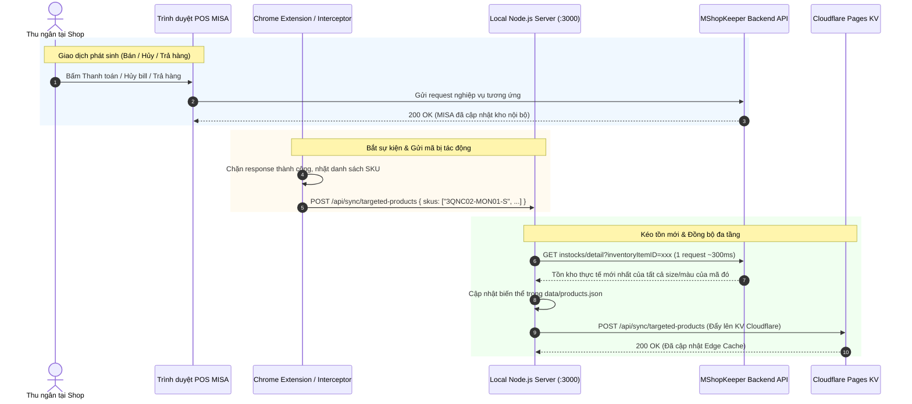

# KẾ HOẠCH ĐỒNG BỘ TỒN KHO TỨC THÌ (REAL-TIME TARGETED SYNC)
> **Dự án:** Tra Cứu Tồn Kho Cobe Denim (MShopKeeper MISA)  
> **Trạng thái:** Bản thiết kế kiến trúc & kế hoạch hành động (Chờ triển khai)  
> **Ngày lập:** 13/10/2026

---

## 1. Đặt Vấn Đề & Mục Tiêu

### 1.1. Hiện trạng
* Hệ thống hiện đồng bộ định kỳ theo lô (**Batch Sync mỗi 2 tiếng**) hoặc khi người dùng bấm nút đồng bộ thủ công.
* Khi quét toàn bộ kho (~1.000 mẫu và hàng ngàn biến thể size/màu), hệ thống phải gửi nhiều đợt request đến API MShopKeeper, mất từ 1 - 2 phút.
* **Hạn chế:** Khi thu ngân tại shop vừa thanh toán bán hết 1 chiếc áo/quần, hệ thống tra cứu trực tuyến vẫn có thể hiển thị còn hàng trong tối đa 2 tiếng tiếp theo, dẫn đến CTV tư vấn và chốt nhầm đơn ảo.

### 1.2. Mục tiêu
* Bắt kịp thời gian thực mọi biến động tồn kho tại quầy thu ngân với độ trễ **dưới 1 giây**.
* **Đồng bộ mục tiêu (Targeted Sync):** Chỉ cập nhật đúng sản phẩm có biến động thay vì quét lại toàn bộ kho.
* Bao quát đầy đủ các tình huống nghiệp vụ: **Bán hàng (Thanh toán)**, **Hủy hóa đơn**, **Đổi / Trả hàng**.

---

## 2. Các Tình Huống Nghiệp Vụ Tại Quầy Thu Ngân (POS)

| Nghiệp vụ | Hành động của Thu ngân trên POS MISA | Biến động kho thực tế | Endpoint MShopKeeper tương ứng |
| :--- | :--- | :--- | :--- |
| **Thanh toán đơn hàng** | Bấm *"Thanh toán"* / *"In hóa đơn"* | **Giảm tồn** các SKU trong hóa đơn | `POST /backendg2/api/SAInvoice` |
| **Hủy hóa đơn** | Bấm *"Hủy hóa đơn"* đối với đơn vừa lập | **Hoàn tồn (Tăng lại)** các SKU trong đơn | `POST /backendg2/api/SAInvoice/Cancel` hoặc `DELETE ...` |
| **Đổi / Trả hàng** | Bấm *"Trả hàng"* / *"Lập phiếu đổi trả"* | **Tăng tồn** món trả, **Giảm tồn** món đổi mới | `POST /backendg2/api/SAReturn` |
| **Kiểm kê / Sửa kho** | Bấm *"Lưu phiếu điều chỉnh kho"* | Cập nhật số tồn thực tế mới | `POST /backendg2/api/StockAdjustment` |

---

## 3. Nguyên Tắc Cốt Lõi (Architecture Principles)

### ⚠️ Nguyên tắc 1: "Không Tự Tính Toán Cộng Trừ" (Zero-Local-Math)
* **Tuyệt đối không:** Dùng code local tự làm `stock = stock - 1` (khi thanh toán) hoặc `stock = stock + 1` (khi hủy đơn).
* **Lý do:** Tự cộng trừ rất dễ sai lệch nếu xảy ra mất mạng, người dùng click đúp (duplicate request), hoặc MISA có cơ chế trừ kho khác.
* **Quy chuẩn:** Bất kể là thanh toán, hủy đơn hay trả hàng:
  $$\text{Sự kiện xảy ra} \longrightarrow \text{Trích xuất SKU} \longrightarrow \text{Gọi MISA lấy con số tồn kho thực tế ngay tại giây đó}$$
  MShopKeeper là **Nguồn chân lý duy nhất (Single Source of Truth)**.

### ⚡ Nguyên tắc 2: Tối ưu tải kết nối (Sub-Second Query)
* Khi chỉ lấy tồn kho cho **1 sản phẩm**, MISA cung cấp endpoint chi tiết `instocks/detail?inventoryItemID=...`.
* Request này phản hồi cực nhanh (**200ms - 400ms**). Toàn bộ quy trình từ lúc in bill đến khi web tra cứu có số mới chỉ mất **~0.8 giây**.

---

## 4. Sơ Đồ Kiến Trúc Hoạt Động (Workflow)



---

## 5. Chi Tiết Các Thành Phần Cần Xây Dựng

### 5.1. Thành phần 1: API Đồng bộ Cục bộ (`/api/sync/targeted-products`)
* **Vị trí:** Cài đặt trên cả [server.js](file:///d:/FPT/project/TRA_CUU_MISA/server.js) (Local) và [functions/api/sync/](file:///d:/FPT/project/TRA_CUU_MISA/functions/api/sync/) (Cloudflare Edge).
* **Đầu vào (Body):**
  ```json
  {
    "action": "invoice_paid", // hoặc "invoice_canceled", "item_returned"
    "skus": ["3QNC02-MON01-S", "3APL01-DEN-M"]
  }
  ```
* **Xử lý:**
  1. Tra cứu ngược từ danh sách SKU để tìm mã cha (`parentSku`) và `InventoryItemID`.
  2. Gọi `instocks/detail` tới MShopKeeper với `InventoryItemID` đã tìm được.
  3. Cập nhật lại số lượng các biến thể trong `products.json` (Local) và ghi đè vào `INVENTORY_KV` (Cloudflare).
  4. Trả về kết quả sau ~300ms.

### 5.2. Thành phần 2: Chrome Extension / Userscript trên máy POS Thu ngân
* **Môi trường hoạt động:** Chạy trên trình duyệt Chrome / Cốc Cốc / Edge tại máy thu ngân bán hàng của cửa hàng (trang `cobedenim.mshopkeeper.vn` hoặc `pos.mshopkeeper.vn`).
* **Kỹ thuật:** 
  - Hook vào `window.fetch` và `XMLHttpRequest.prototype.send` của trang Web POS.
  - Bộ lọc URL cần lắng nghe:
    - `api/SAInvoice` (Tạo hóa đơn thanh toán).
    - `api/SAInvoice/Cancel` hoặc `api/SAInvoice/*` method `DELETE` (Hủy đơn).
    - `api/SAReturn` (Đổi trả hàng).
  - Khi phát hiện phản hồi `status: 200` và `Success: true`:
    - Quét nội dung `Details` hoặc dữ liệu hóa đơn để trích xuất mảng `SKUCode`.
    - Gửi ngầm (asynchronous background) sang `http://localhost:3000/api/sync/targeted-products`.

---

## 6. Lộ Trình Triển Khai (Roadmap)

| Giai đoạn | Nội dung công việc | Kết quả đầu ra |
| :--- | :--- | :--- |
| **Giai đoạn 1** | Viết endpoint `/api/sync/targeted-products` trong `server.js` | Test chạy thử bằng cURL cập nhật 1 mã SP thành công trong < 500ms |
| **Giai đoạn 2** | Viết endpoint hỗ trợ cập nhật đơn lẻ trên Cloudflare Functions & KV | Cloudflare KV cập nhật tức thì sản phẩm đó |
| **Giai đoạn 3** | Xây dựng Chrome Extension / Script bắt sự kiện POS trên Chrome máy thu ngân | Khi thu ngân ấn thanh toán / hủy hóa đơn, script tự bắn API |
| **Giai đoạn 4** | Kiểm thử thực tế tại cửa hàng với 3 kịch bản: Bán hàng, Hủy bill, Trả hàng | Đảm bảo kho trên web tra cứu nhảy số chính xác 100% |

---

## 7. Ghi Chú An Toàn & Dự Phòng (Fail-safe)
1. **Nếu mất kết nối mạng Local:**
   - Hệ thống quét định kỳ 2 tiếng (`auto-sync`) vẫn đóng vai trò là "lưới an toàn" để tự động bù đắp dữ liệu nếu có bất kỳ giao dịch nào bị lỡ.
2. **Bảo mật:**
   - Endpoint `/api/sync/targeted-products` chỉ chấp nhận kết nối từ `localhost` hoặc có kèm mã Secret Token để tránh bị spam từ bên ngoài.
